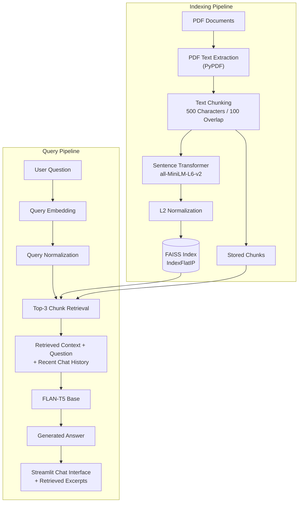

<div align="center">

# 📚 PDF RAG Chatbot

**Ask questions about your PDFs in natural language, and inspect the exact excerpts used to answer.**

Built with **Retrieval-Augmented Generation (RAG)**, Sentence Transformers, FAISS, Hugging Face Transformers, and Streamlit.

<p>
  
  
  
  
  
  <a href="https://github.com/muneer-ahmad10/Chatbot/actions">
    
  </a>
</p>

[Overview](#-overview) •
[Features](#-key-features) •
[Architecture](#-architecture) •
[How It Works](#-how-it-works) •
[Tech Stack](#-technology-stack) •
[Getting Started](#-installation-and-usage) •
[Testing](#-testing-and-continuous-integration) •
[Limitations](#-limitations) •
[Roadmap](#-future-improvements)

</div>

---

## 📖 Overview

Finding specific information in lengthy PDF documents can be time-consuming. This project combines semantic retrieval with a text-generation model to help users find relevant information and ask questions about their documents.

The application extracts PDF text, divides it into overlapping chunks, converts those chunks into embeddings, retrieves relevant passages using FAISS, and supplies the retrieved context to a language model to generate an answer.

It also includes automated unit tests and a GitHub Actions workflow to validate key text-processing and retrieval behaviors.

### At a Glance

| | |
|---|---|
| **Chunking** | 500 characters, 100 overlap |
| **Embeddings** | `all-MiniLM-L6-v2` |
| **Retrieval** | FAISS `IndexFlatIP`, top 3 chunks |
| **Generation** | `google/flan-t5-base` |
| **Interface** | Streamlit chat |
| **Tests** | 5 pytest cases, run through GitHub Actions |

---

## ✨ Key Features

<table>
  <tr>
    <td width="50%" valign="top">

**📂 Input & Processing**

- **Multiple PDF uploads:** Upload multiple PDF files within a session.
- **PDF text extraction:** Extract available text using PyPDF.
- **Text chunking:** Split extracted text into 500-character chunks with 100-character overlap.

**🔎 Retrieval & Generation**

- **Semantic embeddings:** Generate embeddings with `all-MiniLM-L6-v2`.
- **FAISS retrieval:** Retrieve the top three relevant chunks using normalized vectors and inner-product similarity.
- **Context-based generation:** Generate responses using `google/flan-t5-base`.

  </td>
    <td width="50%" valign="top">

**💬 User Experience**

- **Conversational interface:** Ask questions through Streamlit's chat interface.
- **Source inspection:** Review retrieved text excerpts and their source PDF filenames.

**⚡ Performance**

- **Model caching:** Cache loaded models to reduce repeated initialization.
- **Session-based reuse:** Use uploaded-file hashes to identify unchanged documents and reuse processed chunks and the FAISS index.

**🧪 Quality**

- **Automated testing:** Validate chunking, retrieval ranking, empty-index handling, and top-k behavior with pytest.
- **Continuous integration:** Run automated tests through GitHub Actions on pushes and pull requests.

  </td>
  </tr>
</table>

---

## 🏗️ Architecture



---

## ⚙️ How It Works

<details open>
<summary><b>1. PDF Text Extraction</b></summary>

<br>

The application uses `pypdf.PdfReader` to extract available text from uploaded PDF files. Pages without extractable text are skipped, and documents without usable text trigger a warning.

</details>

<details open>
<summary><b>2. Text Chunking</b></summary>

<br>

Extracted text is divided into smaller, overlapping chunks using `RecursiveCharacterTextSplitter`.

| Parameter | Value |
|---|---|
| Chunk size | 500 characters |
| Chunk overlap | 100 characters |
| Library | LangChain Text Splitters |

Chunking allows the retrieval system to search smaller passages instead of processing an entire document as one unit. Overlap helps preserve context around chunk boundaries.

</details>

<details open>
<summary><b>3. Embedding Generation</b></summary>

<br>

The `all-MiniLM-L6-v2` Sentence Transformer converts document chunks and user questions into dense vector representations.

These embeddings enable semantic retrieval, helping the application find passages related to a question even when the wording differs.

</details>

<details open>
<summary><b>4. Vector Indexing and Retrieval</b></summary>

<br>

The application converts document embeddings to `float32`, normalizes them using `faiss.normalize_L2`, and stores them in a FAISS `IndexFlatIP` index.

When a question is submitted:

1. The question is converted into an embedding.
2. The query vector is normalized.
3. FAISS searches for the most similar document chunks.
4. The application selects up to three results, depending on the number of indexed chunks.
5. The retrieved passages are passed to the generation model.

> For normalized vectors, inner-product ranking corresponds to cosine-similarity ranking.

</details>

<details open>
<summary><b>5. Answer Generation</b></summary>

<br>

The application uses Hugging Face Transformers with `google/flan-t5-base` to generate answers from the retrieved context.

The prompt instructs the model to answer using the supplied document context, provide a direct response, and acknowledge when the requested information is not specified.

Recent conversation history is also included to support follow-up questions. However, prompt instructions alone cannot guarantee that every answer is accurate or free from hallucinations.

</details>

<details open>
<summary><b>6. Source Inspection</b></summary>

<br>

Retrieved passages are displayed in expandable sections alongside their source PDF filenames. This gives users a way to inspect the evidence returned by the retrieval component.

The current implementation displays excerpts and filenames rather than page-number citations.

</details>

<details open>
<summary><b>7. Caching and Session Handling</b></summary>

<br>

The application uses Streamlit resource caching for model loading. It also calculates SHA-256 hashes for uploaded files to identify document sets and reuse previously processed chunks and the FAISS index when the uploads remain unchanged.

</details>

---

## 🧰 Technology Stack

| Layer | Component | Technology |
|---|---|---|
| **Core** | Programming language | Python |
| | User interface | Streamlit |
| **Document processing** | PDF extraction | PyPDF |
| | Text splitting | LangChain Text Splitters |
| **Retrieval** | Embedding model | `all-MiniLM-L6-v2` |
| | Vector search | FAISS |
| | Similarity index | `IndexFlatIP` |
| **Generation** | Text-generation model | `google/flan-t5-base` |
| | Model framework | Hugging Face Transformers |
| | Deep learning | PyTorch |
| **Utilities** | Numerical processing | NumPy |
| **Quality & workflow** | Testing | pytest |
| | Continuous integration | GitHub Actions |
| | Development notebooks | Jupyter / Google Colab |

---

## 📁 Project Structure

```text
Chatbot/
├── .github/
│   └── workflows/
│       └── test.yml          # GitHub Actions test workflow
├── tests/
│   └── test_app.py           # Automated unit tests
├── app.py                    # Streamlit interface and RAG pipeline
├── retrieval.py              # FAISS retrieval logic
├── text_processing.py        # Text chunking utility
├── requirements.txt          # Project dependencies
├── Chatbot.ipynb             # Development notebook
├── RAG_ChatBot.ipynb         # RAG experimentation notebook
└── README.md                 # Project documentation
```

---

## 🚀 Installation and Usage

### Prerequisites

- Python 3.10 or newer recommended; the CI workflow uses Python 3.12.
- Git installed on your system.
- Internet access for downloading pretrained models on the first run.
- Adequate RAM and storage for the embedding and generation models.

### Setup

**1. Clone the repository**

```bash
git clone https://github.com/muneer-ahmad10/Chatbot.git
cd Chatbot
```

**2. Create a virtual environment**

<details>
<summary>macOS / Linux</summary>

```bash
python3 -m venv .venv
source .venv/bin/activate
```

</details>

<details>
<summary>Windows</summary>

```bash
python -m venv .venv
.venv\Scripts\activate
```

</details>

**3. Install dependencies**

```bash
python -m pip install --upgrade pip
pip install -r requirements.txt
```

**4. Run the application**

```bash
streamlit run app.py
```

Open the local URL printed in your terminal, upload one or more text-readable PDF files, and ask questions about their contents.

---

## 🧪 Testing and Continuous Integration

The repository includes automated unit tests using **pytest** and a **GitHub Actions** workflow that runs tests on pushes and pull requests targeting `main` or `master`.

### Test Coverage

| Test | Validation |
|---|---|
| Long-text chunking | Multiple non-empty chunks are generated |
| Short-text chunking | Short text is handled correctly |
| Retrieval ranking | The most relevant chunk is returned first |
| Empty-index handling | Retrieval returns empty results when the index is empty |
| Top-k behavior | Retrieval returns the requested number of results |

### Test Results

| Metric | Result |
|---|---|
| Automated test cases | 5 |
| Local test run | 5 passed |
| GitHub Actions | Successful workflow run |
| Test framework | pytest |
| CI environment | Ubuntu with Python 3.12 |

These tests use deterministic sample vectors to validate retrieval behavior without relying on live language-model responses.

### Run Tests Locally

Install the test dependencies:

```bash
python -m pip install numpy faiss-cpu langchain-text-splitters pytest
```

Run the test suite:

```bash
python -m pytest tests/ -v
```

### Testing Resources

- [Automated test suite](https://github.com/muneer-ahmad10/Chatbot/blob/main/tests/test_app.py)
- [GitHub Actions workflow](https://github.com/muneer-ahmad10/Chatbot/blob/main/.github/workflows/test.yml)
- [GitHub Actions run history](https://github.com/muneer-ahmad10/Chatbot/actions)

> **Evaluation scope:** The existing automated tests validate text chunking and core retrieval behavior. They do not constitute a quantitative benchmark of end-to-end answer accuracy, hallucination rates, or performance across a large collection of PDFs.

---

## ⚠️ Limitations

| Area | Detail |
|---|---|
| **Answer reliability** | The generation model can produce inaccurate or unsupported answers despite context-focused prompting. |
| **Scanned PDFs** | Image-only PDFs require OCR, which is not currently implemented. |
| **Retrieval settings** | The application uses a fixed top-three retrieval configuration, which may not be optimal for every document. |
| **Source citations** | Retrieved excerpts include source filenames but do not currently provide page-level citations. |
| **Evaluation scope** | Automated tests cover core processing and retrieval behavior, not comprehensive answer-quality evaluation. |
| **Dependency reproducibility** | Dependencies are listed in `requirements.txt`, but package versions are not fully pinned. |
| **Resource requirements** | Pretrained models may require significant memory and startup time. |
| **Production readiness** | The project demonstrates a local RAG application and automated component tests; it has not been established as a production-grade service. |

---

## 🗺️ Future Improvements

**Evaluation**

- [ ] Create a question-answer evaluation dataset containing answerable and unanswerable questions.
- [ ] Evaluate retrieval with metrics such as Recall@k.
- [ ] Measure answer faithfulness and correctness against reference answers.
- [ ] Experiment with chunk sizes, overlap, and retrieval thresholds.

**Features & Robustness**

- [ ] Add page-level citations for retrieved passages.
- [ ] Improve handling of scanned, corrupted, and empty PDFs.
- [ ] Improve insufficient-evidence detection and handling of conflicting passages.

**Engineering**

- [ ] Add automated tests for PDF extraction and end-to-end answer generation.
- [ ] Pin and validate dependency versions in a clean environment.
- [ ] Explore efficient inference and persistent deployment options.

---

## 🎯 Skills Demonstrated

`Python` `Natural Language Processing` `Retrieval-Augmented Generation (RAG)` `Semantic Search` `Text Embeddings` `FAISS` `Hugging Face Transformers` `Prompt Engineering` `PDF Processing` `Streamlit` `Unit Testing` `GitHub Actions` `Continuous Integration`

---

## 👤 Author

**Muneer Ahmad Dar**

| | |
|---|---|
| **GitHub** | [muneer-ahmad10](https://github.com/muneer-ahmad10) |
| **Project repository** | [PDF RAG Chatbot](https://github.com/muneer-ahmad10/Chatbot) |
| **Development notebook** | [RAG_ChatBot.ipynb](https://github.com/muneer-ahmad10/Chatbot/blob/main/RAG_ChatBot.ipynb) |
| **Additional notebook** | [Chatbot.ipynb](https://github.com/muneer-ahmad10/Chatbot/blob/main/Chatbot.ipynb) |

<div align="center">

---

*An applied NLP project exploring semantic document retrieval, context-informed question answering, and automated testing of core retrieval components.*

</div>
